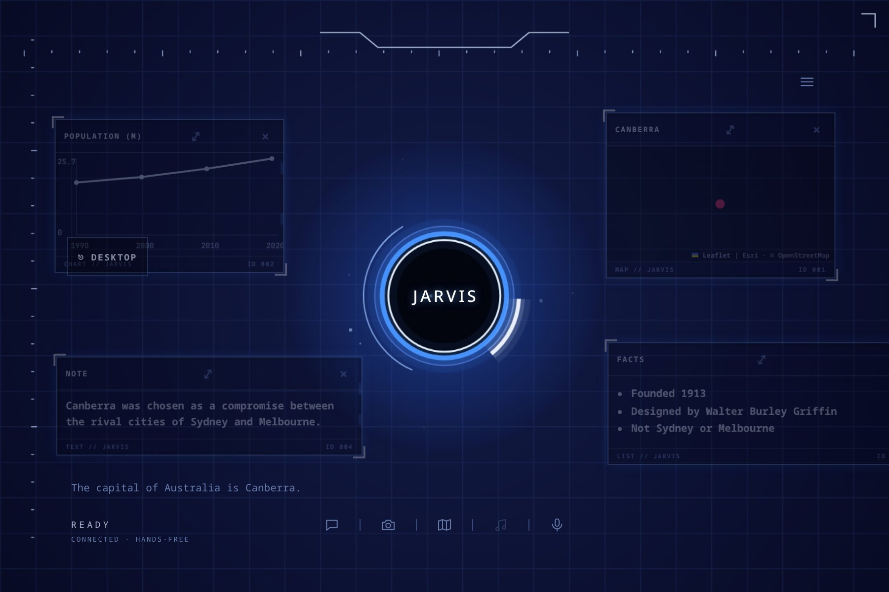
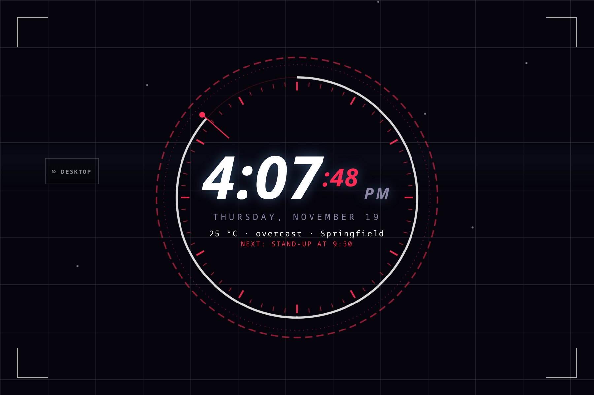

<h1 align="center">Jarvis</h1>
<p align="center"><b>A local-first voice assistant with a full-screen sci-fi HUD, built for a small fanless laptop.</b><br>
Speak to it, it answers out loud, shows maps, pictures, videos and live camera views with labelled boxes, runs a terminal, and keeps your data on your machine.</p>

<p align="center">


</p>

> **Independent hobby project.** Not affiliated with, endorsed by or sponsored by Marvel, Disney or any other company. "Jarvis" is a working title: if the name is a problem for you, rename the folder, the window class and the persona names in `jarvis/personas.py` (see [Name](#name)).

## What it is

Jarvis is a voice assistant for one specific kind of machine: a **Surface Go 1** (Pentium Gold 4415Y, no fan) running **Omarchy / Hyprland** on Wayland. Speech recognition, wake phrases and text to speech run **locally**. The "brain" is [Claude Code](https://claude.com/claude-code) on **your own login** (no API key is stored or needed), and it is only ever allowed to pick from a short list of actions that the code then validates and runs.

Two themes share everything: **Jarvis** (blue) and **Rose** (red), each with its own voice, name and look.

## Features

| | |
|---|---|
| **Voice** | Wake phrases ("Hey Jarvis" / "Hey Rose"), hands-free conversation (it keeps the mic open when it asks you something), hold-to-talk key, interrupt while it speaks, speaking speed per voice, mute, dictation into any window |
| **HUD** | Full-screen Chromium page with an animated orb, cards (text, lists, charts, weather, maps, picture galleries, research reports), a native Wayland overlay orb you can drag and tap to expand, light/lite mode for the weak CPU, two themes |
| **Maps** | Dark OpenStreetMap map card, routes by car, on foot or by bike with travel times, "near me" searches, "show Starbucks on the map", route line that stays visible at every zoom, typed address with live suggestions |
| **Look** | "Look at this": a full-screen view of your phone camera, USB webcam or screen, with thin glowing labelled boxes around what the brain recognises. Tap a box to select it and ask about it. Live and freeze, send to your Mac |
| **Phone as a camera** | IP Webcam or DroidCam over your own Wi-Fi, address checker and test button |
| **Pictures and video** | Picture galleries by default for places, animals, things; videos in the Jarvis frame with play, close and full screen |
| **Windows** | Movable, resizable, minimisable windows for videos, maps, pages, a **terminal** (real shell or Claude Code in a folder you choose) and a **files** browser, all inside the Jarvis screen; a window switcher for your other apps; an always-visible **DESKTOP** button and `SUPER+ESCAPE` to leave to the normal desktop without closing anything |
| **Mac inbox** | Pair a Mac once; send it links, maps and files over a signed, outbound-only channel; the Mac replies "opened" or "dropped: reason" |
| **Phone alerts** | Send a note to your phone through ntfy with a private random topic; read back new alerts |
| **Music** | YouTube music in the frame; optional Spotify (own developer app, Premium, a player called "Jarvis") |
| **Memory and routine** | Remembers short facts (refuses passwords and card numbers), reminders and timers that survive restarts, notes, shopping lists, morning briefing, scenes, quiet hours, focus timer |
| **Research** | A research mode that runs searches in parallel and checks every cited link against what was really fetched, marking uncertain claims |
| **Machine care** | Health report, quiet warnings (a small chip only when something stays bad), a supervisor that restarts whatever dies, a restart limiter, a clock screen saver |
| **Clock** | A HUD clock screen after a quiet time you choose (30 s to 30 min or never), seconds, 12/24 hour, burn-in shift, about 15% of one core while showing |
| **Tools** | Translate mode with per-language voices, read-this-to-me (screenshot + OCR), unit/currency/time answers, QR codes |

## Screenshots

<p align="center">


</p>
<p align="center">


</p>
<p align="center">


</p>
<sub>The map in the cards image is the Canberra demo card. Map data © OpenStreetMap contributors. The Look image is a drawn demo scene, not a photo.</sub>

## Hardware and what to expect

Built and tested on a Surface Go 1: 2 cores / 4 threads at 1.6 GHz, 8 GB RAM, no fan, a USB webcam optional (the built-in IPU3 cameras are not supported and nothing here loads their modules). Typical timings on that machine: the first spoken word about 1 to 3 seconds after the brain starts answering (Piper on this CPU is the floor), a picture request answered by code in about a second, research about 20 seconds. Everything is written to stay light: CSS animation instead of per-frame JavaScript, a pooled browser window that is recycled when idle, a lite mode that switches on by itself when the CPU is hot.

## Install

You need Arch/Omarchy with Hyprland, a microphone and speakers on PipeWire, and a Claude account for Claude Code.

```sh
sudo pacman -S --needed python python-gobject gtk4 gtk4-layer-shell python-cairo ffmpeg pipewire wireplumber chromium grim
sudo pacman -S --needed tesseract qrencode wtype brightnessctl yt-dlp libnotify   # optional features
git clone <this repository> ~/jarvis        # it must live in ~/jarvis (the Hyprland file uses $HOME/jarvis)
cd ~/jarvis && ./install.sh
```

`install.sh` builds `.venv`, downloads two Piper voices (about 63 MB each, from Hugging Face `rhasspy/piper-voices`) and the wake-word model (about 5 MB, from the sherpa-onnx releases). The speech model (`tiny.en`, about 75 MB) downloads on first start. Nothing about you is sent anywhere by the installer.

Then:

1. Add `dofile(os.getenv("HOME") .. "/jarvis/hypr/jarvis.lua")` to `~/.config/hypr/bindings.lua` and run `hyprctl reload`.
2. Install Claude Code and log in once: run `claude`.
3. Check everything: `bin/jarvis-doctor` (it prints no private data and tells you what is missing).
4. Start it: `bin/jarvis-watch &` (the supervisor; it also starts at login after step 1).

## First run

* Say **"Hey Jarvis"** (or hold `SUPER+J`) and ask something.
* **Set your location** (nothing trusts a rough IP guess for "near me"): say "set my location" and type your address in the card, pick a suggestion, confirm it on the map. It is saved only in `~/.config/jarvis/settings.json`.
* Open **MENU > SETTINGS** for speed, volume, clock, warnings, shortcuts.

### Pair a Mac (optional)
Say "pair my Mac". A card shows the steps, the exact command and a one-time code (shown only on screen). On the Mac, get this repository's `mac/` folder (clone or ZIP), paste the command, type the code. The card turns to "Mac connected"; "send test to my Mac" proves delivery. Run `python3 jarvis_inbox.py install` there to start it at login. See [`mac/README.md`](mac/README.md).

### Set up Spotify (optional, needs Premium)
Say "set up Spotify" and follow the card: create your own app at developer.spotify.com with the redirect `http://127.0.0.1:8888/callback`, paste the Client ID (no secret is needed: PKCE login), log in on Spotify's own page, and run a Spotify Connect player named "Jarvis" (spotifyd or librespot, installed by you). Nothing is shared with anyone; tokens stay in `~/.config/jarvis` (mode 600). If Spotify refuses, music falls back to YouTube.

### Phone camera (optional)
Install IP Webcam (Android) or DroidCam (Android/iPhone), open **SETTINGS > Camera > Phone camera**, type just the phone's IP, press SAVE then TEST. Jarvis tries `http`, the app's default port and the usual video paths and saves the one that works. Only addresses on your own network are accepted.

## Keyboard shortcuts

| Keys | Does |
|---|---|
| hold `SUPER+J` | talk, release to send |
| hold `SUPER+SHIFT+L` | look at the camera/screen and talk |
| `SUPER+SHIFT+J` | orb <-> full screen |
| hold `SUPER+SHIFT+D` | dictate into the focused window |
| `SUPER+ALT+M` | mute (deaf mode) |
| `SUPER+ALT+J` | back to the Jarvis window |
| `SUPER+ESCAPE` | **abort**: leave Jarvis full screen for the normal desktop (press again to return). Works even if Jarvis hung |
| `Alt+T` | switch theme (changeable in settings; never fires while you type) |
| `Esc` | close the front card, window or settings |

## A few things to say

"set my location" · "show Starbucks on the map" · "directions to the airport" · "look at this" · "box the cup" · "freeze" · "show me pictures of a red panda" · "show me how to tie a tie" · "research how red pandas survive" · "send that to my Mac" · "text me the address" · "remind me in ten minutes" · "speak faster" · "clock after 10 minutes" · "turn off machine warnings" · "switch to the terminal" · "how's the machine" · "translate to Spanish" · "go to the corner" · "back to Jarvis"

## How it works

```
mic --> wake phrase (sherpa-onnx) --> speech to text (faster-whisper) --> local skills first (timers, volume, maps, ...)
                                                                      \--> the brain (claude -p, stream-json) --> ONE JSON intent from a fixed list
                                                                                                                       |
Piper voice <-- first sentence streamed <-- reply ------------------------ code validates the intent and runs ONLY that action
                                                                                   |
                     Chromium kiosk page (cards, maps, windows, look, clock) + native GTK4 layer-shell orb + Hyprland window control
```

* `jarvis/core.py` the assistant loop, `jarvis/intents.py` the allowlisted intents, `jarvis/actions.py` page-triggered actions, `jarvis/opener.py` windows and Hyprland, `jarvis/web/` the HUD.
* A watchdog (`jarvis/watchdog.py`) restarts the server, page, orb and brain when they die, with a restart limiter.

## Safety and privacy

* **The AI never runs shell text.** It can only name an intent (`show_map`, `directions`, `search_web`, `show_images`, `show_video`, `send_to_mac`, `send_to_phone`, `open_app`, `answer`); the code validates it. Sends to your Mac or phone only happen if your own words said send, text or share. The terminal is for your typing only: nothing in the assistant can reach it.
* **The terminal** listens on `127.0.0.1` only, needs a random per-start token the page receives over its own websocket, checks Host and Origin, starts only when you open it, and dies with its window.
* **Secrets** (pairing code, ntfy topic, tokens) are never printed, logged or committed. See [`config.example/`](config.example/README.md) for where private data lives.
* **What leaves your machine, and when:** your questions, and screenshots or camera frames when you ask it to *look*, go to Claude through Claude Code. Map tiles, geocoding, routing, weather, Wikipedia pictures and YouTube are fetched only when a request needs them (a rough city-level IP lookup only if no home location is set and you ask for "near me"; the clock screen asks Open-Meteo for the weather at your home location every ten minutes while it is showing). Alerts go through ntfy.sh to a random private topic. Nothing else is sent. Details and terms: [`THIRD_PARTY.md`](THIRD_PARTY.md).
* While Jarvis runs it raises Omarchy's screensaver timer so its own clock screen is used, and puts the original value back when it exits (`jarvis/syshold.py`).

## Troubleshooting

Run `bin/jarvis-doctor`. Logs are in `logs/`. If the full-screen page is stuck, press `SUPER+ESCAPE`.

## Name

The persona names live in `jarvis/personas.py` and the window class in `bin/jarvis-ui`; the Hyprland rules in `hypr/jarvis.lua` match on that class. If you want a neutral project name instead of "Jarvis", good options are **Heyorb**, **Lumen Voice**, **Localvox**, **Pocket Orb** or **Halo Desk**.

## Licence

MIT, see [`LICENSE`](LICENSE). Third-party components keep their own licences: [`THIRD_PARTY.md`](THIRD_PARTY.md). Contributions: [`CONTRIBUTING.md`](CONTRIBUTING.md).
